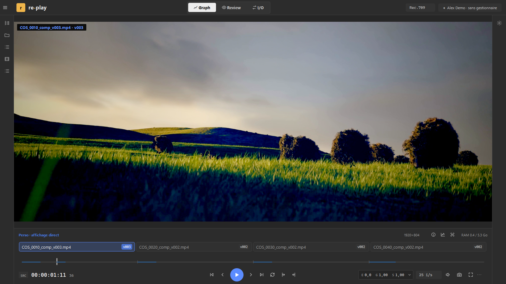
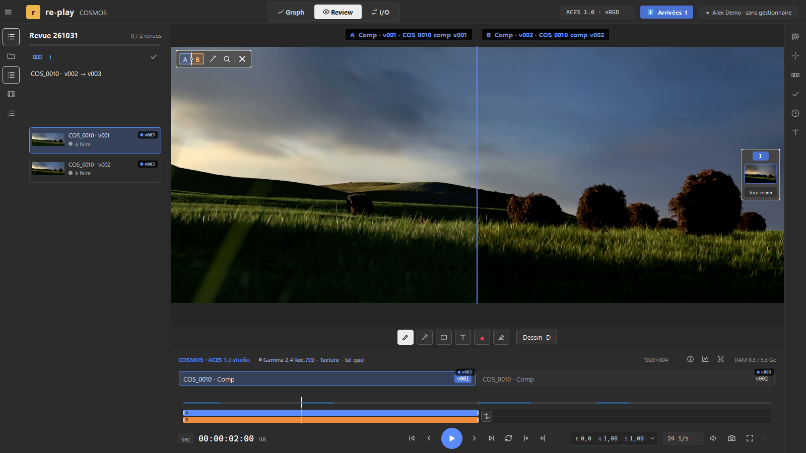
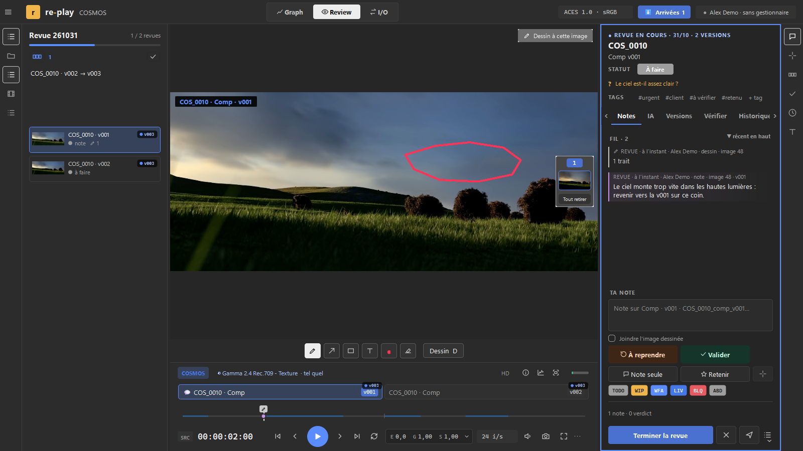
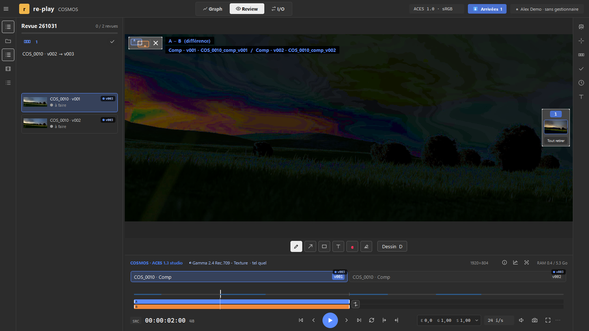
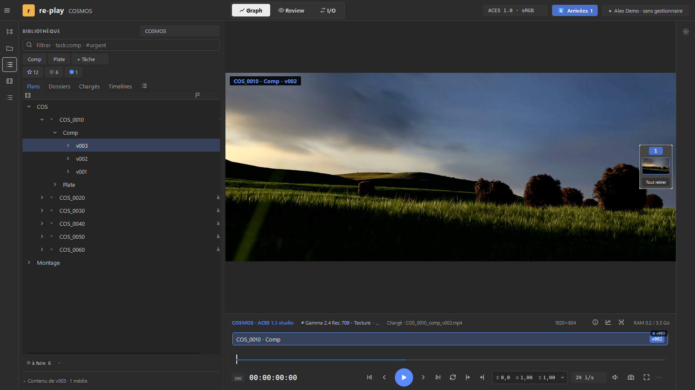

Version française : [README.md](README.md)

# re-play

**A bridge between production, making and supervision.** re-play is a free tool made for freelancers and small studios, bringing five families of tools into one
place:

- **project setup**: create and configure a project (folders, shots, settings) before starting;
- **conform**: turn an edit back into shots, find the right versions;
- **input / output**: receive media (ingest), organize it, transcode, send it on to other software;
- **review**: compare versions, take notes, draw on the image, give a verdict;
- **AI**: a help for transfers and checks; it never decides, you do.

Windows · Mac (Apple silicon) · Linux — English and French — no account, no server, no telemetry.

**[⬇ Download the latest version](https://github.com/coreetgraph/re-play/releases/latest)** ·
[Give feedback](https://tally.so/r/WJ25qL) · [Discord](https://discord.gg/BDAKUGz5jp)

> Test version (alpha). It may contain bugs. Opened media are never modified and nothing is sent automatically.

## What re-play does

- **Play**: EXR, PNG, ProRes, H.264, 10-bit video with alpha, image sequences, edits (EDL, OTIO, AAF, XML) and 3D files, with
  correct color (OCIO / ACES). Frame by frame, loop, full screen.
- **Compare**: two versions as a wipe, a difference or a grid; jump from one version to the next with one key.
- **Check your shots**: artists can verify their own work with checking tools before sending it.
- **Review**: verdicts, notes, drawings on the image, PDF export of the review.
- **Send feedback back** to Kitsu, ShotGrid, a messaging app or a dated delivery. Every connection is optional, and
  nothing leaves without your click.
- It works on its own, on a plain folder. No AI is built in: the one you already use plugs in alongside, if you want.

## Plug into your pipeline

Every piece is optional and switched on separately:

- **MCP**: an AI can read projects, versions and notes, and drop proposals. This lets you build your own AI setup. It never
  approves anything and nothing leaves without your click ([docs/POUR_LES_IA.md](docs/POUR_LES_IA.md), in French).
- **Plug-ins**: they install inside your other software (Nuke, Blender, ComfyUI…) so you can use re-play from within.
- **Connectors**: to talk to asset and production managers (Kitsu, ShotGrid…).
- **Actions**: they call scripts to process media in batches on export, or to create a Nuke setup from presets
  ([docs/KITSU_ACTION.md](docs/KITSU_ACTION.md), in French).

## Install

On the [Releases](https://github.com/coreetgraph/re-play/releases/latest) page, one file per system:

| System | File | Install |
|---|---|---|
| Windows 10 / 11, 64-bit | `re-play_<version>_Windows_<date>.exe` | Run the installer (no admin rights needed). |
| Mac with Apple silicon (M1 and later), macOS 14 and later | `re-play_<version>_Mac_<date>.dmg` | Drag `re-play` into Applications. See [docs/MAC.md](docs/MAC.md) (in French). |
| Linux 64-bit, Ubuntu 26.04 and later | `re-play-<version>-x86_64.AppImage` | Make the file executable, then open it. See [docs/LINUX.md](docs/LINUX.md) (in French). |

The program is not signed yet: on first launch, Windows may show "Windows protected your PC" (*More info* > *Run anyway*), and
on Mac you allow it in *System Settings > Privacy & Security* > *Open Anyway*.

A test version expires 60 days after it was built (the date is in *Help > About*). A new version installs over the old one and
keeps your settings. What changes between versions: [CHANGELOG.md](CHANGELOG.md) (in French).

## First steps

1. Drag a media file or a folder onto the window.
2. Space: play; ← →: frame by frame; ↑ ↓: previous or next clip; V: clip versions; D: draw; Shift+R: review panel.
3. The [tester guide](docs/TESTER_GUIDE.md) suggests five things to try with a demo pack.

## Give feedback, report a problem

- **Easiest: the [form](https://tally.so/r/WJ25qL)** (English or French, a few lines are enough, no account needed).
- **On GitHub**: the [Issues](https://github.com/coreetgraph/re-play/issues/new/choose) tab (bug, idea, question). Needs a free
  GitHub account.
- **To chat**: the [Discord](https://discord.gg/BDAKUGz5jp), channels `re-play-help`, `re-play-bugs`, `re-play-ideas`; new
  versions are announced in `re-play-news`.
- In re-play, *Help > Send feedback…* prepares a report (version, system, end of the log) to read through, then copy. Paths,
  names and tokens are masked.
- Please never attach a real confidential shot.
- Contact: re-play@coreetgraph.com.

## Support the project

re-play is free. Donations help dedicate more time to it: [donate with PayPal](https://www.paypal.me/FauchereSebastien).

## Licenses

re-play is distributed under the [Apache 2.0](LICENSE) license; its source code is not published for now. Third-party components
(Qt, FFmpeg, OpenImageIO, OpenColorIO…) keep their own licenses: see [NOTICE](NOTICE) (in French).

## Screenshots

Taken on a demo project built with shots from the open movie *Cosmos Laundromat* (© Blender Foundation,
[cosmoslaundromat.org](https://www.cosmoslaundromat.org), CC-BY 4.0). No client shot. The screenshots show the French
interface; the English one is identical.

A review: a drawing on the image, a note, and the feedback thread on the right.

Difference mode shows what changed.

The library: shots, versions and statuses of the project.

---

*re-play is made by Sebastien Fauchère (Core et Graph).*
