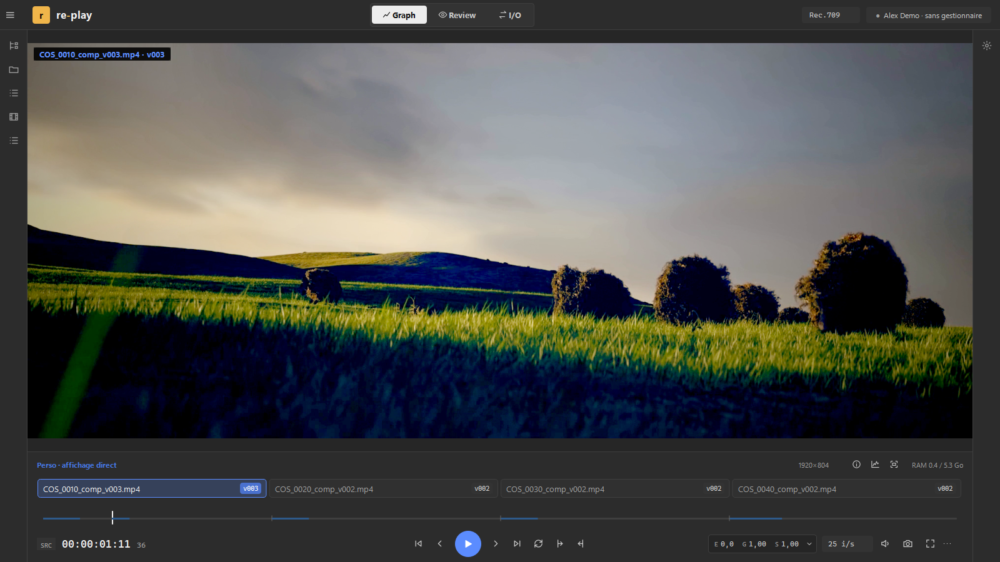
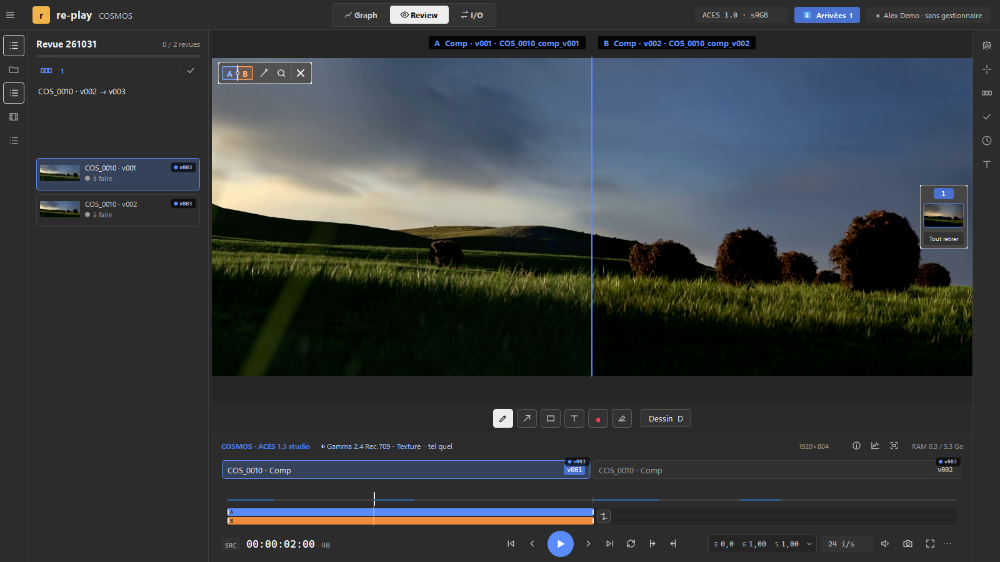
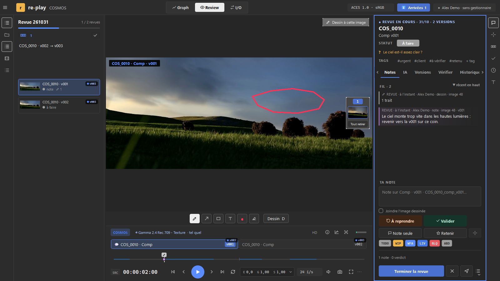
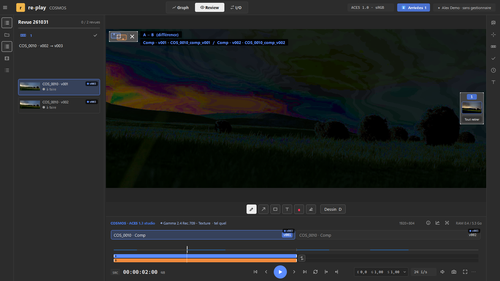
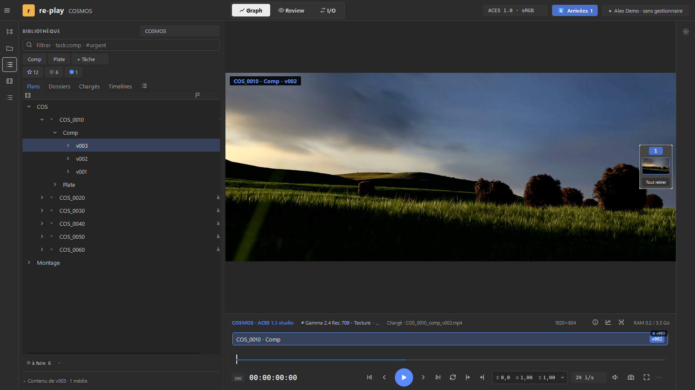

English version: [README.en.md](README.en.md)

# re-play

**Un pont entre la production, la fabrication et la supervision.** re-play est un outil gratuit, pensé pour les indépendants et les petites boîtes, qui réunit au même endroit
cinq familles d'outils :

- **la préparation des projets** : créer et configurer un projet (dossiers, plans, réglages) avant de commencer ;
- **la conformation** : remettre un montage en plans, retrouver les bonnes versions ;
- **les entrées et sorties** : recevoir les médias (ingest), les ranger, transcoder, envoyer vers les autres logiciels ;
- **la revue** : comparer les versions, noter, dessiner sur l'image, donner un verdict ;
- **l'IA** : une aide pour les transferts et les vérifications ; elle ne décide jamais, c'est toi qui valides.

Windows · Mac (puce Apple) · Linux — français et anglais — sans compte, sans serveur, sans télémétrie.

**[⬇ Télécharger la dernière version](https://github.com/coreetgraph/re-play/releases/latest)** ·
[Donner un avis](https://tally.so/r/WJ25qL) · [Discord](https://discord.gg/BDAKUGz5jp)

> Version de test (alpha). Elle peut contenir des erreurs. Les médias ouverts ne sont jamais modifiés et rien n'est envoyé
> automatiquement.

## Ce que fait re-play

- **Lire** : EXR, PNG, ProRes, H.264, vidéo 10 bits avec alpha, séquences d'images, montages (EDL, OTIO, AAF, XML) et fichiers
  3D, avec la couleur juste (OCIO / ACES). Image par image, boucle, plein écran.
- **Comparer** : deux versions en volet, en différence ou en mosaïque ; passer d'une version à l'autre d'une touche.
- **Vérifier ses plans** : le graphiste contrôle son travail avec des outils de vérification avant de l'envoyer.
- **Donner son avis** : verdicts, notes, dessins sur l'image, export PDF de la revue.
- **Renvoyer l'avis** vers Kitsu, ShotGrid, une messagerie ou un envoi daté. Chaque lien est facultatif, et rien ne
  part sans ton clic.
- Il marche seul, sur un simple dossier. Aucune IA n'est intégrée : celle que tu utilises déjà se branche à côté, si tu le veux.

## Se brancher à son pipeline

Chaque brique est facultative et s'active à part :

- **MCP** : une IA peut lire les projets, les versions et les notes, et déposer des propositions. Tu peux ainsi te construire
  ton propre setup IA. Elle ne valide jamais et rien ne part sans ton clic ([docs/POUR_LES_IA.md](docs/POUR_LES_IA.md)).
- **Plug-ins** : ils s'installent dans les autres logiciels (Nuke, Blender, ComfyUI…) pour utiliser re-play depuis l'intérieur.
- **Connecteurs** : pour parler aux gestionnaires d'assets et de production (Kitsu, ShotGrid…).
- **Actions** : elles font appel à des scripts pour traiter des médias en lot à l'export, ou créer un setup Nuke à partir de
  préréglages ([docs/KITSU_ACTION.md](docs/KITSU_ACTION.md)).

## Installer

Sur la page [Releases](https://github.com/coreetgraph/re-play/releases/latest), un fichier par système :

| Système | Fichier | Installation |
|---|---|---|
| Windows 10 / 11, 64 bits | `re-play_<version>_Windows_<date>.exe` | Lancer l'installeur (sans droits administrateur). |
| Mac à puce Apple (M1 et plus), macOS 14 et plus | `re-play_<version>_Mac_<date>.dmg` | Glisser `re-play` dans Applications. Voir [docs/MAC.md](docs/MAC.md). |
| Linux 64 bits, Ubuntu 26.04 et plus | `re-play-<version>-x86_64.AppImage` | Rendre le fichier exécutable, puis l'ouvrir. Voir [docs/LINUX.md](docs/LINUX.md). |

Le programme n'est pas encore signé : au premier lancement, Windows peut afficher « Windows a protégé votre ordinateur »
(*Informations complémentaires* > *Exécuter quand même*), et le Mac demande une autorisation dans *Réglages Système >
Confidentialité et sécurité* > *Ouvrir quand même*.

Une version de test expire 60 jours après sa fabrication (la date est dans *Aide > À propos*). Une nouvelle version s'installe
par-dessus l'ancienne et garde les réglages. Ce qui change d'une version à l'autre : [CHANGELOG.md](CHANGELOG.md).

## Premiers pas

1. Glisser un média ou un dossier sur la fenêtre.
2. Espace : lecture ; ← → : image par image ; ↑ ↓ : clip précédent ou suivant ; V : versions du clip ; D : dessiner ;
   Maj+R : panneau de revue.
3. Le [guide du testeur](docs/GUIDE_TESTEUR.md) propose cinq choses à essayer avec un pack de démonstration.

## Donner un avis, signaler un problème

- **Le plus simple : le [formulaire](https://tally.so/r/WJ25qL)** (français ou anglais, quelques lignes suffisent, pas besoin
  de compte).
- **Sur GitHub** : l'onglet [Issues](https://github.com/coreetgraph/re-play/issues/new/choose) (bug, idée, question). Il faut
  un compte GitHub gratuit.
- **Pour discuter** : le [Discord](https://discord.gg/BDAKUGz5jp), salons `re-play-help`, `re-play-bugs`, `re-play-ideas` ;
  les nouvelles versions sont annoncées dans `re-play-news`.
- Dans re-play, *Aide > Envoyer un retour…* prépare un rapport (version, système, fin du journal) à relire, puis à copier.
  Chemins, noms et jetons y sont masqués.
- Merci de ne jamais joindre un vrai plan confidentiel.
- Contact : re-play@coreetgraph.com.

## Soutenir le projet

re-play est gratuit. Les dons permettent d'y consacrer plus de temps :
[faire un don avec PayPal](https://www.paypal.me/FauchereSebastien).

## Licences

re-play est distribué sous licence [Apache 2.0](LICENSE) ; son code source n'est pas publié pour l'instant. Les composants tiers
(Qt, FFmpeg, OpenImageIO, OpenColorIO…) gardent leur propre licence : voir [NOTICE](NOTICE).

## Captures

Faites sur un projet de démonstration monté avec des plans du film libre *Cosmos Laundromat* (© Blender Foundation,
[cosmoslaundromat.org](https://www.cosmoslaundromat.org), CC-BY 4.0). Aucun plan de client n'y figure.

Une revue : un dessin sur l'image, une note, et le fil des retours à droite.

La comparaison en différence fait ressortir ce qui a changé.

La bibliothèque : plans, versions et statuts du projet.

---

*re-play est fait par Sebastien Fauchère (Core et Graph).*
